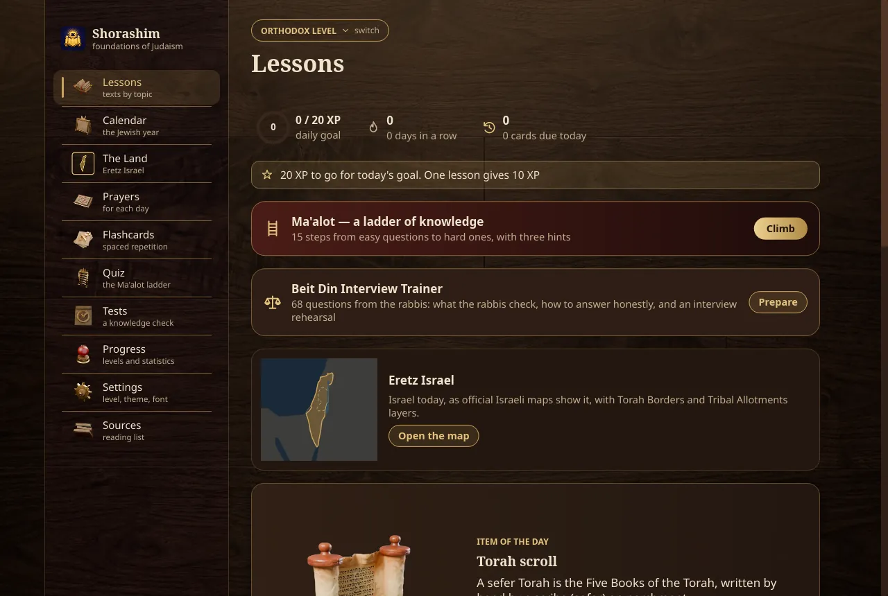
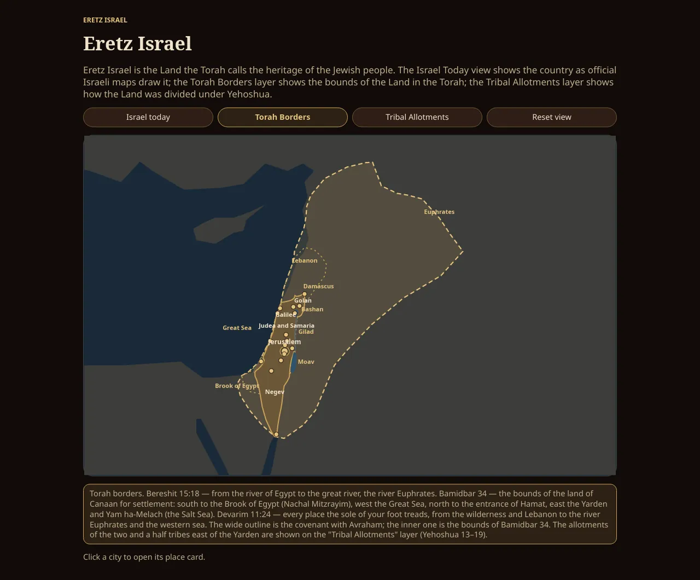
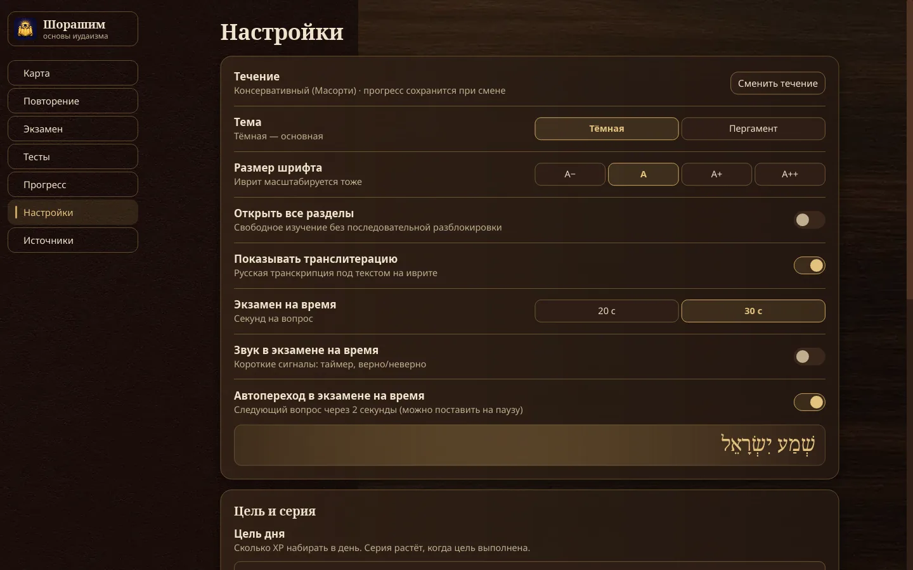

# Shorashim

Shorashim (Hebrew for “roots”) is an offline Windows app for studying the foundations of Judaism and for calm, step-by-step preparation for **giyur** and the **beit din** interview.

The course is written in the language of Torah and Tanakh — the Written and Oral Torah. It is consistently pro-Israel: Eretz Israel is the heritage the Torah gives the Jewish people, Jerusalem is the eternal undivided capital, and the State of Israel is the Jewish people’s return home.

**[Download Shorashim-Setup.exe](https://github.com/Mitroshenkov87/shorashim/releases/latest)** — Windows 10 or 11, for the current user, no administrator rights needed. Russian is also available; the screenshots below are from the English version.



## Features

- **Lessons**, about 5–10 minutes each, in eight sections: from the foundations of faith to the beit din. Each lesson can be read at the Orthodox, Conservative (Masorti) or Reform level. Every movement is presented on its own terms, with equal care.
- **Flashcards** with spaced repetition (1 → 3 → 7 → 14 → 30 days), including how a point is taught in the other movements.
- **Quiz** and **Ma'alot**, a 15-step ladder of knowledge from easier questions to harder ones, with hints.
- **Tests** on each section, plus a general exam, with a review of mistakes.
- **Beit din interview trainer**: reading the topics, multiple-choice practice, and a rehearsal in which you can also answer aloud.
- **Jewish calendar**: the date, the day’s meaning, the weekly Torah portion, and candle-lighting and fast times for a chosen place.
- **Prayers**, with Hebrew, translation and transliteration (for example the Shema).
- **Map of Eretz Israel.** The default view, **Israel today**, follows official Israeli maps. A separate **Borders by the Torah** layer shows the bounds of the Land in the Torah (Bereshit 15:18, Bamidbar 34, Devarim 11:24). A **Tribal allotments** layer follows Yehoshua 13–19.
- **3D objects** you can turn with the mouse (a Torah scroll, and more), and optional quiet instrumental music (off by default, in Settings).
- **Reviewer mode**, so a rabbi or a tester can open any part of the app without changing a student’s progress.






## English and Russian

The app is in **English** and **Russian**. On first launch it follows the Windows interface language: Russian Windows opens the app in Russian; any other Windows language opens it in English. You can switch later in Settings; your progress is kept.

The English name of the app is Shorashim; the Russian name is Шорашим.

## Download and install

1. Open the **[latest release](https://github.com/Mitroshenkov87/shorashim/releases/latest)**.
2. Download **`Shorashim-Setup.exe`** — that is the only file you need.
3. Run the installer. It unpacks the program, the `content` folder (lessons, cards, questions, prayers and the calendar) and the music, creates shortcuts, and starts Shorashim.

Progress is stored separately, in `%APPDATA%\Shorashim`, and is left as it is if you install the app again. Everything works offline.

## Course content

Lessons, cards, quiz questions, the interview trainer, prayers and calendar texts are ordinary JSON files in `content/ru/` and `content/en/`, next to the program — nothing of this is built into the `.exe`. A wording fix is an edit to a file and a short repack of the installer; Rust does not need to be compiled again. The two languages keep the same file names and the same ids, so progress carries over when you switch language.

A short guide to editing and checking the files is in [`docs/CONTENT-UPDATES.md`](docs/CONTENT-UPDATES.md). If a file is missing or invalid, the app shows a calm message with the file, the line and what is wrong; it does not crash.

## Rabbi review

All course content is checked by a rabbi. The checklists are:

- [`docs/RABBI-REVIEW.md`](docs/RABBI-REVIEW.md) — Russian
- [`docs/RABBI-REVIEW.en.md`](docs/RABBI-REVIEW.en.md) — English

They share the same item ids (lessons, cards, questions, interview items, prayers, calendar days and map notes). A remark on an item applies to both languages.

If you are a rabbi or a knowledgeable reader and would like to help, please [open an issue](https://github.com/Mitroshenkov87/shorashim/issues/new) and cite the item id. The app helps you study; it does not replace a teacher.

## Support

Donations go to AI tokens used to develop the app.

Donations (TRON TRC-20, USDT or TRX): `TYveZBXaSpM4FEHa6iGrc7A6zuLfS4z3x6`  
Send only via the TRON (TRC-20) network; other networks lose funds permanently.

## Build from source

Rust stable ([rustup](https://rustup.rs)):

```sh
cargo run --release
cargo test
# Windows .exe from Linux (needs mingw-w64):
rustup target add x86_64-pc-windows-gnu
cargo build --release --target x86_64-pc-windows-gnu
```

Command control for tests and agents (off by default, localhost only): `shorashim --control`, `shorashim ctl …`, `shorashim --headless` — see [`docs/AUTOMATION.md`](docs/AUTOMATION.md).

Fonts: Noto (SIL OFL 1.1), DejaVu Sans (DejaVu Fonts license).

## License

Copyright 2026 Aleksandr Mitroshenkov. [Apache License 2.0](LICENSE) — see also [`NOTICE`](NOTICE).
