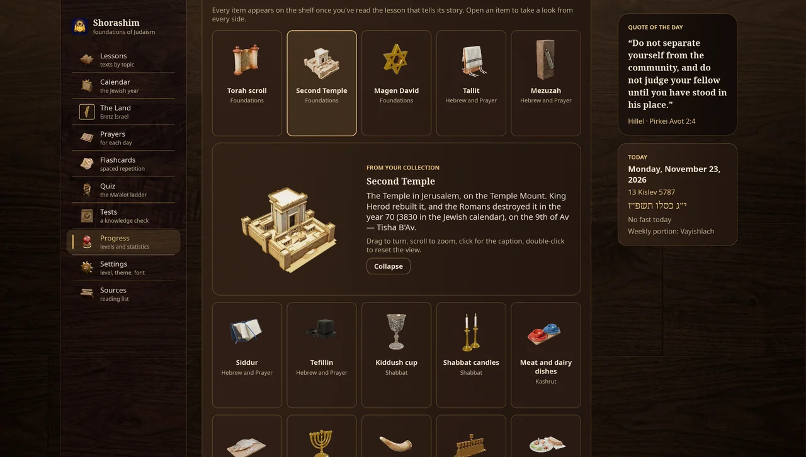

# Shorashim

Shorashim means “roots.” It is an offline app for Windows, macOS and Linux for studying the foundations of Judaism and for calm, step-by-step preparation for **giyur** and the **beit din** interview.

The course is written in the language of Torah and Tanakh — the Written and Oral Torah. It is consistently pro-Israel: Eretz Israel is the heritage the Torah gives the Jewish people, Jerusalem is the eternal undivided capital, and the State of Israel is the Jewish people’s return home.

**[Download Shorashim-Setup.exe](https://github.com/Mitroshenkov87/shorashim/releases/latest)** — Windows 10 or 11, for the current user, no administrator rights needed.

**[Download Shorashim-macOS.dmg](https://github.com/Mitroshenkov87/shorashim/releases/latest/download/Shorashim-macOS.dmg)** — Apple Silicon Mac (M1 or newer), macOS 11 or later.

**[Download Shorashim-x86_64.AppImage](https://github.com/Mitroshenkov87/shorashim/releases/latest/download/Shorashim-x86_64.AppImage)** — Linux, 64-bit (x86_64); make it executable and run it, no installation needed.

So far we have tested Shorashim only on Windows. The macOS and Linux builds are provided as well, but have not been tested by us yet.

**[User guide](docs/Shorashim-User-Guide.pdf)** — a short PDF on installing the app and using each part of it.


Giyur is a path, not a cram session. Shorashim walks with you: short lessons, honest practice, and the questions a beit din actually asks — so you can answer in your own words, not from a memorized script.



Open a 3D **Second Temple** and turn it with the mouse — look at it from every side. Other objects join your collection as you study.

## Prepare for the beit din

The judges want to know who you are, why you have come, and how you already live. The **beit din interview trainer** gathers the questions rabbis ask, and explains what lies behind them. These are not ready-made answers to memorize. You can read the topics at your own pace, practice with multiple-choice questions, and rehearse — including out loud.


## Learn a little every day

**Lessons** take about 5–10 minutes each, in eight sections — from the foundations of faith to the beit din. Every lesson can be read at the Orthodox, Conservative (Masorti) or Reform level. Each movement is presented on its own terms, with equal care.


**Flashcards** with spaced repetition (1 → 3 → 7 → 14 → 30 days) help the ideas stay with you, including how a point is taught in the other movements.


**Ma'alot** is a 15-step ladder of knowledge, from easier questions to harder ones, with hints when you need them. Section **tests** and a general exam let you review your mistakes in peace.

## Prayer, the calendar, and a Torah you can turn

**Prayers** come with Hebrew, a translation and a transliteration — the Shema, and more — so you can learn the words with your eyes and your mouth.

The **Jewish calendar** shows the date, the meaning of the day, the weekly Torah portion, and candle-lighting and fast times for a place you choose.


The collection also holds other **3D objects** you can turn — a Torah scroll, a sukkah, and more. If you like, you can play quiet instrumental music (off by default, in Settings).

A **reviewer mode** lets a rabbi or a tester open any part of the app without changing a student’s progress.

## Download and install

1. Open the **[latest release](https://github.com/Mitroshenkov87/shorashim/releases/latest)**.
2. Download **`Shorashim-Setup.exe`** — that is the only file you need.
3. Run the installer. It unpacks the program, the `content` folder (lessons, cards, questions, prayers and the calendar) and the music, creates shortcuts, and starts Shorashim.

Progress is stored separately, in `%APPDATA%\Shorashim`, and is left as it is if you install the app again. Everything works offline.

### macOS

1. Download **`Shorashim-macOS.dmg`** from the **[latest release](https://github.com/Mitroshenkov87/shorashim/releases/latest)**.
2. Open it and drag **Shorashim** onto **Applications**.
3. The app is not signed with an Apple developer ID yet, so the first time macOS will not open it with a double click. Right-click (or Control-click) **Shorashim** in Applications and choose **Open**, then **Open** again. On macOS 15 or later, if there is no Open button, go to **System Settings → Privacy & Security** and click **Open Anyway**. After that it opens normally.

Progress is stored in `~/Library/Application Support/Shorashim`.

### Linux

1. Download **`Shorashim-x86_64.AppImage`** from the **[latest release](https://github.com/Mitroshenkov87/shorashim/releases/latest)**.
2. Make it executable and run it:

   ```sh
   chmod +x Shorashim-x86_64.AppImage
   ./Shorashim-x86_64.AppImage
   ```

   Or right-click the file → Properties → allow it to run as a program, then double-click it. If your system has no FUSE, run it as `./Shorashim-x86_64.AppImage --appimage-extract-and-run`.

Progress is stored in `~/.local/share/Shorashim` (or `$XDG_DATA_HOME/Shorashim`).

## Course content

Lessons, cards, quiz questions, the interview trainer, prayers and calendar texts are ordinary JSON files in a `content` folder next to the program — nothing of this is built into the `.exe`. A wording fix is an edit to a file and a short repack of the installer; Rust does not need to be compiled again.

A short guide to editing and checking the files is in [`docs/CONTENT-UPDATES.md`](docs/CONTENT-UPDATES.md). If a file is missing or invalid, the app shows a calm message with the file, the line and what is wrong; it does not crash.

## Rabbi review

All course content must be checked by a rabbi. The checklists are:

- [`docs/RABBI-REVIEW.md`](docs/RABBI-REVIEW.md)
- [`docs/RABBI-REVIEW.en.md`](docs/RABBI-REVIEW.en.md)

They share the same item ids (lessons, cards, questions, interview items, prayers and calendar days).

If you are a rabbi or a knowledgeable reader and would like to help, please [open an issue](https://github.com/Mitroshenkov87/shorashim/issues/new) and cite the item id. The app helps you study; it does not replace a teacher.

## Support

Donations go to AI tokens used to develop the app.

Donations (TRON TRC-20, USDT or TRX): `TYveZBXaSpM4FEHa6iGrc7A6zuLfS4z3x6`  
Send only via the TRON (TRC-20) network; other networks lose funds permanently.

## Build from source

Rust stable ([rustup](https://rustup.rs)):

```sh
cargo run --release
cargo test
# Windows .exe from Linux (needs mingw-w64):
rustup target add x86_64-pc-windows-gnu
cargo build --release --target x86_64-pc-windows-gnu
```

Command control for tests and agents (off by default, localhost only): `shorashim --control`, `shorashim ctl …`, `shorashim --headless` — see [`docs/AUTOMATION.md`](docs/AUTOMATION.md).

Fonts: Noto (SIL OFL 1.1), DejaVu Sans (DejaVu Fonts license).

## License

Copyright 2026 Aleksandr Mitroshenkov. [Apache License 2.0](LICENSE) — see also [`NOTICE`](NOTICE).
